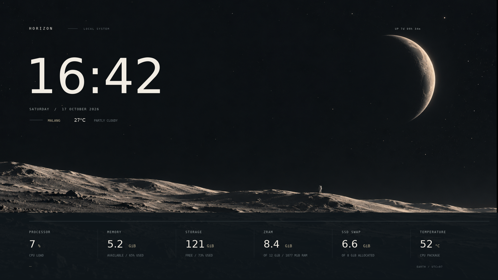
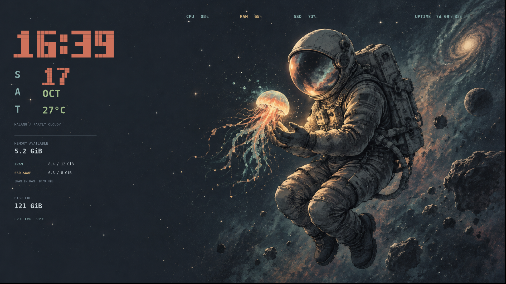

# myDesktop

Konfigurasi dan tema desktop Linux pribadi.

| Tema | Gaya | Source |
|---|---|---|
| **Horizon** | Lunar minimalis, jam tipografi besar, metrik horizontal | [`conky-horizon/`](conky-horizon/) |
| **Orbit** | Astronaut, jam piksel retro, panel metrik di kiri | [`conky-orbit/`](conky-orbit/) |

## Conky Horizon

Alternatif dengan wallpaper lunar, jam besar bernuansa ivory, tanggal dan cuaca yang ringkas, serta enam metrik sistem dalam satu baris. Panel bawah diberi latar gelap agar statistik tetap terbaca di atas permukaan bulan.



*Pratinjau render pada resolusi 1920 × 1080. Nilai metrik pada gambar adalah cuplikan saat render; saat dipasang, nilainya diperbarui dari komputer tujuan.*

Pasang dependensi yang sama seperti Orbit di bawah, lalu jalankan dari sesi desktop tanpa `sudo`:

```bash
cd conky-horizon
python3 install.py
```

Installer mencadangkan wallpaper dan konfigurasi Conky sebelumnya. Untuk memulihkannya:

```bash
python3 ~/.config/conky/Horizon/restore.py
```

Paket portabel: [`Conky-Horizon-portable.tar.gz`](conky-horizon/dist/Conky-Horizon-portable.tar.gz). Lihat [petunjuk Horizon](conky-horizon/PETUNJUK.txt).

## Conky Orbit



*Pratinjau tema pada resolusi 1920 × 1080. Dock dan panel sistem mengikuti konfigurasi desktop masing-masing.*

Tema desktop dengan jam piksel, tanggal, cuaca Malang, wallpaper astronaut, serta metrik CPU, RAM, disk, uptime, swap SSD, dan zram. Widget membaca metrik sistem setiap tiga detik; cuaca diperbarui setiap 15 menit.

Ditujukan untuk Ubuntu/Debian dengan desktop GNOME. Transparansi dan penempatan dapat berbeda menurut compositor; tampilan paling sesuai untuk layar 16:9. Dock, ikon, dan panel GNOME tidak diubah.

### Pemasangan

Pasang dependensi:

```bash
sudo apt update
sudo apt install conky-all python3 fonts-dejavu-core x11-xserver-utils
```

Dari sesi desktop pengguna biasa, jalankan tanpa `sudo`:

```bash
cd conky-orbit
python3 install.py
```

Installer mencadangkan konfigurasi sebelumnya, memasang tema ke `~/.config/conky/Orbit`, mengatur wallpaper dan autostart, lalu menjalankan Conky. Lokasi cuaca bawaan adalah Malang; koordinat dapat diubah di `theme/metrics.py` dan label kota di `theme/orbit.lua`.

Untuk memulihkan tampilan sebelumnya:

```bash
python3 ~/.config/conky/Orbit/restore.py
```

### Paket portabel

Paket siap salin tersedia di [`conky-orbit/dist/Conky-Orbit-portable.tar.gz`](conky-orbit/dist/Conky-Orbit-portable.tar.gz). Untuk membuat ulang setelah mengubah source:

```bash
cd conky-orbit
python3 build-package.py
```

Lihat [petunjuk lengkap](conky-orbit/PETUNJUK.txt) dan [catatan proyek](conky-orbit/README.txt).

### Struktur

- `conky-orbit/theme/` — konfigurasi Conky, renderer Lua/Cairo, kolektor metrik Python, peluncur, dan wallpaper.
- `conky-orbit/install.py` — pemasangan dan pencadangan konfigurasi.
- `conky-orbit/restore.py` — pemulihan konfigurasi sebelum pemasangan.
- `conky-orbit/build-package.py` — pembuatan arsip distribusi.
- `conky-orbit/dist/` — paket portabel.

Wallpaper dibuat menggunakan ImageGen; prompt tersedia di `conky-orbit/theme/wallpaper-prompt.txt`. Data cuaca berasal dari [Open-Meteo](https://open-meteo.com/).
