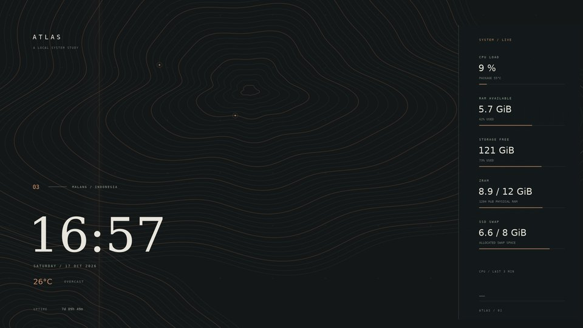
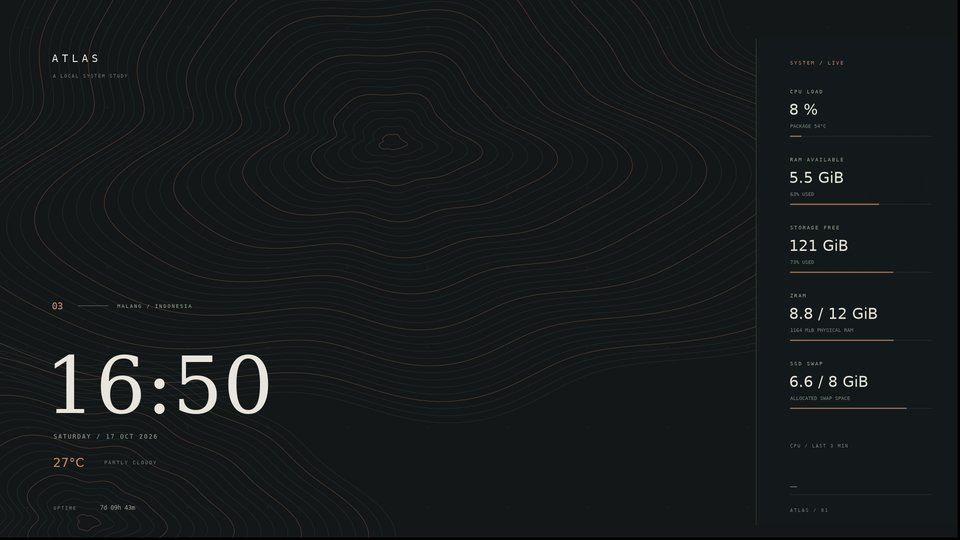
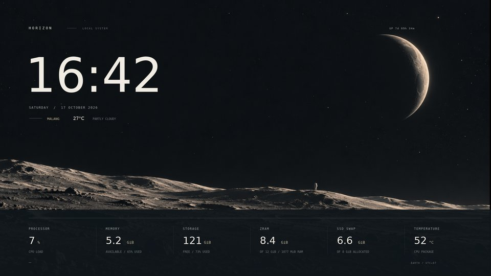
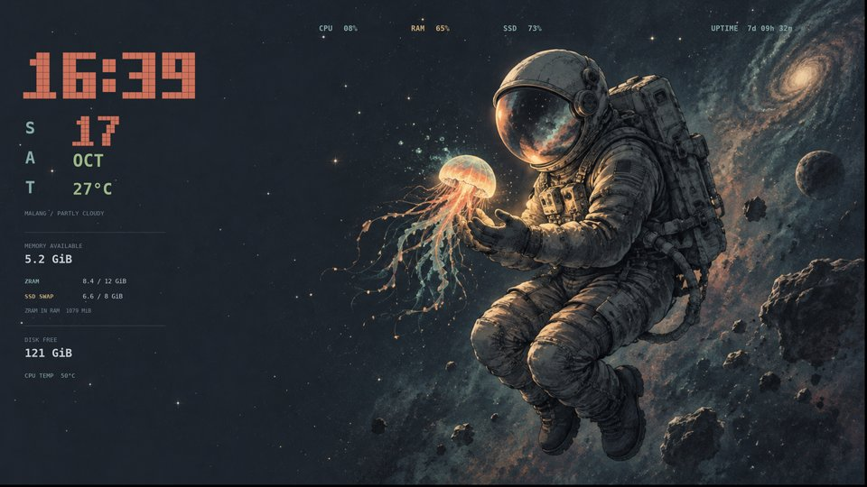

# myDesktop

Konfigurasi dan tema desktop Linux pribadi.

## Galeri tema

Pilih tampilan dari galeri berikut. Klik gambar untuk membuka pratinjau penuh; gambar Atlas Live membuka animasinya.

<table>
  <tr>
    <td width="50%" valign="top">
      <strong>Atlas Live</strong> 
      Kontur bergerak · pemindai tembaga · panel kanan  
        
      <a href="conky-atlas/README.md#atlas-live">Pemasangan</a> · <a href="docs/images/conky-atlas-live-preview.gif">Lihat animasi</a>
    </td>
    <td width="50%" valign="top">
      <strong>Atlas</strong> 
      Topografi statis · aksen tembaga · panel kanan  
        
      <a href="conky-atlas/README.md#atlas-statis">Pemasangan</a> · <a href="conky-atlas/">Source</a>
    </td>
  </tr>
  <tr>
    <td width="50%" valign="top">
      <strong>Horizon</strong> 
      Lanskap bulan · jam minimalis · metrik horizontal  
        
      <a href="conky-horizon/README.md#pemasangan">Pemasangan</a> · <a href="conky-horizon/">Source</a>
    </td>
    <td width="50%" valign="top">
      <strong>Orbit</strong> 
      Astronaut · jam piksel retro · panel kiri  
        
      <a href="conky-orbit/README.md#pemasangan">Pemasangan</a> · <a href="conky-orbit/">Source</a>
    </td>
  </tr>
</table>

*Semua pratinjau memakai rasio 16:9. Nilai sistem pada gambar adalah cuplikan saat render; dock dan panel mengikuti desktop masing-masing. Atlas Live adalah mode animasi dari tema Atlas.*
